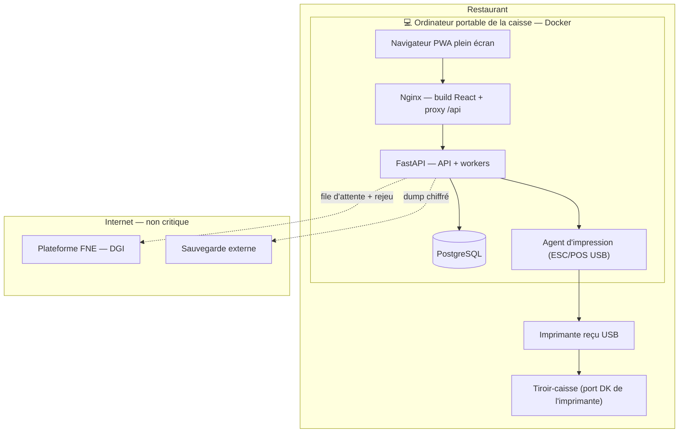
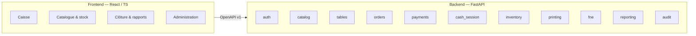
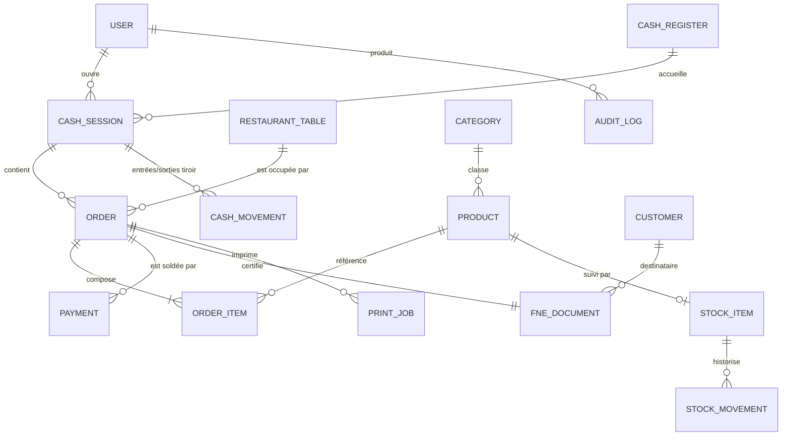
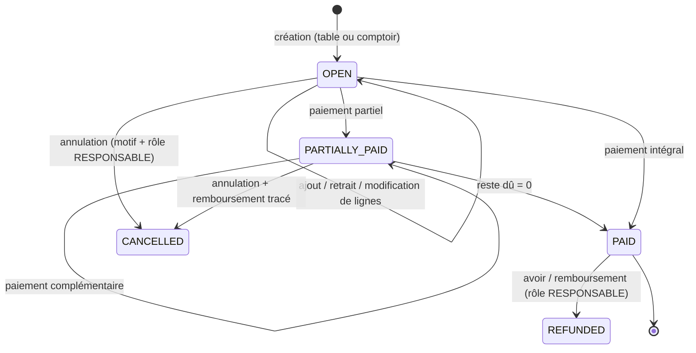
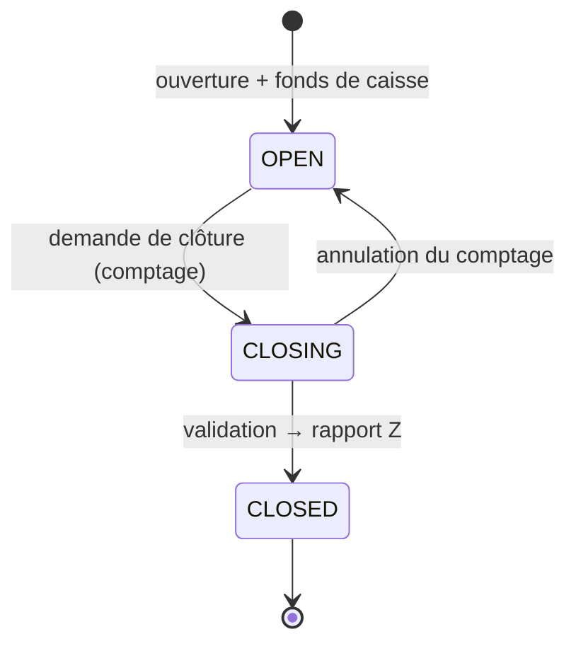
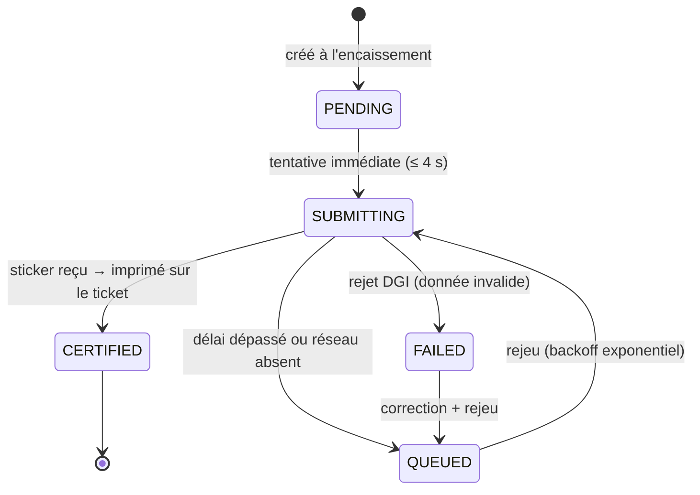
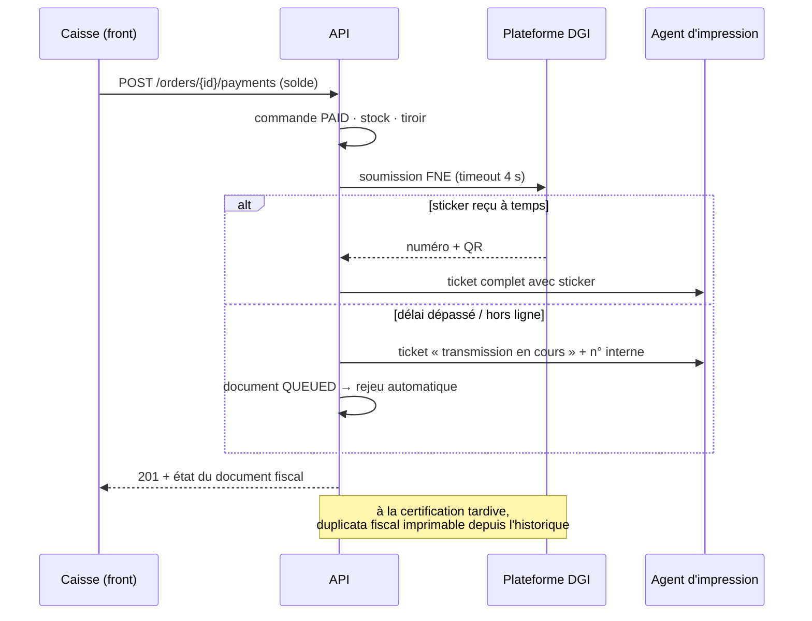

# Architecture globale — Application de caisse restaurant

> Document de référence commun **backend + frontend**.
> À lire en entier par les deux développeurs avant la première ligne de code.
> Documents liés : `01-BACKEND.md`, `02-FRONTEND.md`, `03-CONTRAT-API.md`, `04-EXPLOITATION-BACKEND.md`.

| | |
|---|---|
| Nom de code | **CaisseResto** (à remplacer) |
| Client | Restaurant, Côte d'Ivoire |
| Périmètre | Point de vente (POS) restaurant : commandes à table, encaissement, stock boissons, clôture de caisse, facturation normalisée (FNE) |
| Stack imposée | React + shadcn/ui + Radix UI (front) · FastAPI (back) |
| Équipe | 2 développeurs : 1 backend, 1 frontend |
| Version du doc | **1.1** — intègre les réponses client du 24/09/2026 et la mutualisation d'infrastructure avec le PMS |

### Ce qui a changé depuis la v1.0

| Sujet | v1.0 | v1.1 |
|---|---|---|
| Fiscal | RNE par ticket **ou** récapitulatif journalier (indécis) | **FNE par ticket** → refonte du §8, mode dégradé obligatoire |
| Serveur | Mini-PC dédié | **Ordinateur portable sous Windows 10/11** existant (Docker Desktop / WSL2), mutualisable avec le PMS |
| Imprimante | USB **ou** Ethernet | **USB sous Windows** → agent d'impression sur Spooler Windows / `win32print` (ADR-13) |
| Tiroir-caisse | Non spécifié | **Ouverture au clic sur « Payer »**, simultanée avec le reçu |
| Écran | Tactile | **Clavier + souris d'abord**, tactile plus tard → priorités front inversées |
| Zones de salle | Salle / terrasse / VIP | **Salle uniquement** |
| Saisie | Caissier seul | Les serveurs remettent des **bons papier** à la caissière |
| Infrastructure | Isolée | **§4 — mutualisation Docker/PostgreSQL avec le PMS Hôtel Résidence de la Paix** |

---

## 1. Contexte et objectifs

Le restaurant fonctionne aujourd'hui avec une caisse enregistreuse classique, aujourd'hui défectueuse. L'objectif est de la remplacer par une application couvrant **le cycle complet de la journée** : ouverture de caisse → prise de commande par table → encaissement multi-moyens → impression → clôture → obligations fiscales.

### Objectifs métier (par ordre de priorité)

1. **Zéro ressaisie** — le produit saisi à la commande est celui qui est encaissé, imprimé et déclaré.
2. **Fiabilité de la caisse** — la caisse ne doit jamais s'arrêter, même sans Internet.
3. **Traçabilité** — toute opération est horodatée, attribuée à un utilisateur, non effaçable.
4. **Conformité fiscale** — émission d'une **facture normalisée électronique par ticket**.
5. **Pilotage** — connaître à tout moment les recettes, le stock et la répartition par moyen de paiement.

### Non-objectifs (explicitement hors projet à ce stade)

- Gestion de la production en cuisine (KDS, bons de préparation).
- Comptabilité générale, paie, RH.
- Réservations, fidélité, commande en ligne / livraison.
- Prise de commande par les serveurs sur mobile (ils continuent à remettre un bon papier).

---

## 2. Contraintes et réponses du client

Issues du compte rendu (§15) et des réponses du 24/09/2026.

| # | Point | Réponse / décision | Impact architecture |
|---|---|---|---|
| 1 | Nombre de caisses | **1** | Multi-postes néanmoins prévu dans le modèle |
| 2 | Caissiers | **Une seule caissière** | 1 session par jour, mais modèle multi-utilisateurs conservé pour les remplacements |
| 3 | Imprimante | **USB**, largeur à confirmer (58 ou 80 mm) | → **ADR-13 : agent d'impression** sur la machine où l'imprimante est branchée. Largeur paramétrable |
| 4 | Tiroir-caisse | **Ouverture au clic sur « Payer »**, simultanée avec la sortie du reçu | Commande ESC/POS *drawer kick* envoyée dans le même job que le ticket |
| 5 | Stock | **Boissons et produits revendus uniquement** | Pas de nomenclature/recettes au MVP |
| 6 | Annulations / remboursements | Nécessaires | Jamais de suppression : annulation tracée + motif + rôle requis |
| 7 | Modification de commande | **Oui**, tant que non payée | Machine à états stricte |
| 8 | Remises | **Plus tard** | Modèle prévu, UI masquée |
| 9 | Paiements mixtes | **Oui** | 1 commande → N paiements |
| 10 | Ventes à emporter | **Oui** | `table_id` nullable + « ticket comptoir » dédié |
| 11 | Zones de salle | **Salle uniquement** | Pas d'onglets de zones au MVP, champ `zone` conservé |
| 12 | Saisie des commandes | Les serveurs prennent la commande et **remettent le bon à la caissière** | La saisie est centralisée → **la vitesse de saisie est le critère UX n°1** |
| 13 | Facturation | **FNE par ticket** | → refonte complète du §8 : mode dégradé obligatoire |
| 14 | Coupure Internet | **Doit fonctionner** | → ADR-01 : tout tourne en local sur site |
| 15 | Matériel | **Ordinateur portable** existant, écran tactile **plus tard**, imprimante à reçu + tiroir | Le portable sert de serveur (§3.2) ; le front doit être **clavier/souris d'abord** |
| 16 | Droits | Caissier / Responsable / Admin | Matrice §9 |
| 17 | Sauvegarde / historique | Nécessaire | Sauvegarde locale + copie externe (§`04-EXPLOITATION`) |
| 18 | Tableau de bord | Oui | Module `reporting` dès le MVP |

### Encore ouvert (§14)

- Largeur d'impression exacte (58 / 80 mm) et modèle de l'imprimante.
- Mentions légales à faire figurer sur le ticket (NCC, RCCM, adresse, téléphone).
- Taux de TVA applicable et produits éventuellement exonérés.
- Politique d'arrondi du rendu monnaie (à l'unité ou à 5 F).
- **Mode dégradé autorisé par la DGI** quand la transmission FNE échoue (point bloquant, voir §8.3).

---

## 3. Vue d'ensemble

### 3.1 Principe directeur : *local-first*

La caisse doit fonctionner sans Internet. La réponse n'est pas un mode hors-ligne navigateur, mais le déplacement de tout le système critique **sur le site du restaurant** :

> L'application complète (API, base de données, impression) tourne sur la **machine posée à la caisse**.
> Le navigateur s'y connecte en local (ou en LAN pour un second poste).
> Une coupure Internet n'affecte **aucune** fonction de vente — seules les opérations sortantes (transmission FNE, sauvegarde distante) sont différées et rejouées.

Cela supprime l'essentiel de la complexité d'un vrai mode offline (synchronisation, conflits, numérotation dupliquée).

### 3.2 Le serveur est l'ordinateur portable de la caisse

Le client dispose d'un **ordinateur portable sous Windows 10/11**, pas d'un mini-PC. C'est acceptable et même avantageux, sous conditions :

| Point | Conséquence |
|---|---|
| ✅ Batterie intégrée | Fait office d'onduleur pour le serveur : une coupure de courant ne tue pas la base de données |
| ⚠️ Mais l'imprimante et le routeur sont sur secteur | Un **petit onduleur reste nécessaire** pour l'imprimante, sinon plus de ticket en cas de coupure |
| ⚠️ Mise en veille Windows | La mise en veille, l'hibernation et la suspension sélective USB doivent être **désactivées** dans les options d'alimentation Windows |
| ⚠️ Machine polyvalente | Risque d'arrêt intempestif : `restart: always` sur les conteneurs + Docker Desktop démarré avec Windows + Agent en Service Windows (NSSM) |
| ⚠️ Disque unique | Sauvegardes horaires locales via tâche planifiée PowerShell + copie externe quotidienne (voir `04-EXPLOITATION-BACKEND.md`) |
| 📌 À terme | Migrer vers un mini-PC dédié reste recommandé ; l'architecture est identique, c'est un simple déplacement de conteneurs |

### 3.3 Schéma de déploiement (cible MVP)



L'agent d'impression est un processus distinct précisément parce que l'imprimante est en **USB** : il doit tourner sur la machine physiquement reliée au câble. Aujourd'hui c'est la même machine que l'API ; demain, si l'API déménage (mutualisation, mini-PC, serveur PMS), seul l'agent reste au comptoir.

### 3.4 Découpage logique



Le **contrat OpenAPI** est la seule interface entre les deux développeurs → `03-CONTRAT-API.md`.

---

## 4. Mutualisation de l'infrastructure avec le PMS Hôtel Résidence de la Paix

Le PMS de l'Hôtel Résidence de la Paix (Django + PostgreSQL) tourne déjà sous Docker. Question posée : peut-on y rattacher le backend FastAPI de la caisse, et partager la base ?

**Réponse courte : oui pour la machine et l'instance PostgreSQL, non pour la base de données, et en production seulement si les deux applications servent le même site.**

### 4.1 Les trois niveaux de mutualisation

| Niveau | Ce qui est partagé | Verdict |
|---|---|---|
| **Hôte Docker** (machine, réseau, volumes) | CPU, disque, réseau `bridge` | ✅ **Oui** en développement · ✅ en production **si même site** |
| **Instance PostgreSQL** (un seul conteneur `db`) | Le moteur, pas les données | ✅ **Oui, recommandé** |
| **Base de données / schéma** | Les tables elles-mêmes | ❌ **Jamais** |

### 4.2 Pourquoi jamais la même base

1. **Deux systèmes de migration** — Django migrations et Alembic sur le même schéma : collisions garanties dès la première divergence.
2. **Restauration indépendante** — restaurer une sauvegarde de l'hôtel ne doit jamais écraser les ventes du restaurant, et réciproquement.
3. **Obligations fiscales distinctes** — les données de caisse sont soumises à conservation et à contrôle ; elles doivent être isolables et exportables seules.
4. **Portabilité** — si demain l'un des deux projets déménage sur un autre serveur ou change de client, on emporte sa base sans chirurgie.
5. **Sécurité** — un rôle compromis d'un côté ne doit rien pouvoir lire de l'autre.

Organisation cible :

```
conteneur  db  (postgres:16-alpine)
├── base  hotel_paix   ·  rôle  hotel_paix   ·  utilisé par Django
└── base  caisse       ·  rôle  caisse       ·  utilisé par FastAPI
```

Avec un cloisonnement explicite :

```sql
REVOKE CONNECT ON DATABASE caisse     FROM hotel_paix;
REVOKE CONNECT ON DATABASE hotel_paix FROM caisse;
```

> **Règle absolue** : aucune requête SQL croisée entre les deux applications. Si un jour la caisse doit lire une donnée du PMS, elle passe par l'API HTTP du PMS. Jamais par la base.

### 4.3 Montage Docker

Deux options, selon l'appétence au risque.

**Option A — socle partagé (recommandé)**
PostgreSQL sort du `docker-compose.yml` de l'hôtel et devient un service commun.

```
~/Projets_thio_isaac/
├── infra/                          # NOUVEAU — socle commun
│   ├── docker-compose.yml          # postgres partagé (+ pgadmin optionnel)
│   ├── .env
│   └── init/01-create-caisse.sh    # crée la base et le rôle caisse au 1er démarrage
├── hotel-paix-backend/             # existant, service `db` retiré de son compose
└── caisse-backend/                 # nouveau
```

Les trois `docker-compose.yml` partagent un réseau déclaré externe :

```bash
docker network create infra_shared
```

```yaml
# dans chacun des trois fichiers
networks:
  infra_shared:
    external: true
```

Le nom d'hôte de la base reste `db` pour les deux applications — aucune modification de code côté Django.

**Option B — greffe minimale (zéro risque immédiat)**
On garde le `db` du compose de l'hôtel tel quel, on y ajoute simplement la base et le rôle `caisse`, et le compose de la caisse rejoint le réseau de l'hôtel. C'est faisable en dix minutes, mais le cycle de vie de la base du restaurant devient dépendant du projet hôtel (`docker compose down -v` côté hôtel efface aussi la caisse). Acceptable en développement, à éviter en production.

**Ports sur l'hôte** — un seul service publie le port 5432, les autres passent par le réseau interne :

| Service | Port hôte | Remarque |
|---|---|---|
| PostgreSQL (`infra`) | `5432` | Publié une seule fois, pour pgAdmin |
| Django PMS | `8000` | Inchangé |
| FastAPI Caisse | `8001` | |
| Front caisse (Nginx) | `8080` | ou `80` en production |
| Agent d'impression | `8090` | écoute en local uniquement |

Procédure détaillée, commandes et dépannage : **`04-EXPLOITATION-BACKEND.md`**.

### 4.4 Production : la question qui tranche

La mutualisation en développement (sur ta machine) est un pur gain : un seul `docker compose up`, une seule instance Postgres, un seul pgAdmin. En production, c'est autre chose — tout dépend de la relation entre les deux établissements.

| Cas | Situation | Décision |
|---|---|---|
| **A** | Le restaurant est **celui de l'hôtel** (même site, même contribuable) | ✅ Colocalisation complète sur un serveur unique sur site. Ouvre en plus une intégration métier (§4.5) |
| **B** | Même propriétaire, **deux sites distincts** | ❌ Deux déploiements séparés. Mutualiser un serveur entre deux sites implique un lien réseau permanent entre eux — c'est exactement ce que le principe local-first cherche à éviter |
| **C** | **Clients différents** | ❌ Deux déploiements séparés, isolation stricte. Confidentialité commerciale et responsabilité juridique |

Dans les cas B et C : **mutualisation totale en développement, nulle en production**. Le même socle `infra/` est simplement instancié deux fois, sur deux machines.

> ⚠️ **À trancher avant le lot L7 (mise en production).** Tant que la réponse n'est pas connue, on développe sur le socle mutualisé — cela n'engage rien, puisque le découplage est garanti par la séparation des bases.

### 4.5 Si cas A : intégration métier possible (hors MVP)

Si le restaurant est celui de l'hôtel, la colocalisation permet des ponts qui ont une vraie valeur :

| Fonction | Mécanisme | Phase |
|---|---|---|
| **Imputer une addition sur une chambre** | Moyen de paiement `ROOM_CHARGE` : la caisse appelle `POST /api/sejours/{id}/prestations` du PMS, avec outbox et rejeu si le PMS ne répond pas | V1.2 |
| **Recherche du séjour en cours** | Appel `GET /api/sejours?statut=en_cours` depuis l'écran d'encaissement | V1.2 |
| **Tableau de bord consolidé** | Agrégation hôtel + restaurant, côté PMS ou dans un module tiers | V2.0 |
| **Authentification unique** | Un seul annuaire d'utilisateurs, OIDC ou jeton partagé | V2.1 |

Trois précautions :

1. **Toujours par API, jamais par SQL.** Timeout court (2 s), échec non bloquant, rejeu via outbox.
2. **Le mécanisme d'épargne du PMS (répartition caisse/épargne) ne doit pas absorber automatiquement les recettes du restaurant.** Ce sont deux flux financiers distincts ; toute jonction est une décision de gestion, pas un effet de bord technique.
3. **Numérotation fiscale** — même contribuable ne veut pas dire même séquence de facturation. Vérifier avec le comptable si les deux activités émettent sous le même identifiant et comment les séquences doivent être tenues.

---

## 5. Décisions d'architecture (ADR)

| ID | Décision | Pourquoi | Alternative écartée |
|---|---|---|---|
| **ADR-01** | Déploiement **local-first** sur la machine de la caisse | Répond à la coupure réseau sans complexité de synchronisation | SaaS cloud pur (inutilisable sans Internet) |
| **ADR-02** | **PostgreSQL** (même en local, via Docker) | Transactions sérialisables, contraintes fortes, mutualisation avec le PMS | SQLite : verrouillage global, migration douloureuse ensuite |
| **ADR-03** | **Impression pilotée par le serveur** (`python-escpos`) | Le navigateur ne sait ni piloter un ticket ESC/POS ni ouvrir un tiroir | `window.print()` : rendu imprévisible, pas de tiroir, pas de rejeu |
| **ADR-04** | **Montants en entiers XOF** partout | Le FCFA n'a pas de sous-unité ; zéro erreur d'arrondi | `float` / `decimal` |
| **ADR-05** | **Immutabilité fiscale** après encaissement | Contrôle fiscal et confiance interne | UPDATE/DELETE libres |
| **ADR-06** | **Port + adaptateur** pour la FNE, avec outbox et rejeu | Réseau instable, mode d'intégration DGI à finaliser | Appel synchrone bloquant à l'encaissement |
| **ADR-07** | **Contract-first** : OpenAPI → types TS générés | Les deux devs avancent en parallèle | Coordination orale |
| **ADR-08** | **Clé d'idempotence** sur toute mutation financière | Un double-clic ne doit jamais créer deux paiements | Rien |
| **ADR-09** | Authentification **PIN → JWT court** | Connexion en 2 secondes | Login/mot de passe classique |
| **ADR-10** | Front **PWA plein écran** | Un seul code base, déploiement instantané | Electron/Tauri |
| **ADR-11** | **Monolithe modulaire** côté backend | 2 développeurs, 1 site | Microservices |
| **ADR-12** | **Journée comptable** portée par la session de caisse | Un service peut finir après minuit | `DATE(created_at)` |
| **ADR-13** | **Agent d'impression séparé**, exposé en HTTP local (port 8090) | L'imprimante est en **USB sous Windows** : l'agent tourne en natif (service Windows / NSSM) et utilise l'API Spooler Windows (`win32print` / raw ESC/POS). Cela élimine les conflits de pilotes, fiabilise les déconnexions/reconnexions USB et découple le conteneur API de l'hôte physique | Driver USB direct dans le conteneur API (impossible sous Windows Docker sans VM/USB-IP complexe) ou pilote libusb/Zadig (qui casse les pilotes officiels Windows) |
| **ADR-14** | **Une instance PostgreSQL, deux bases** (caisse / PMS) | Mutualise l'exploitation sans coupler les données ni les migrations | Base commune (collision de migrations, restauration impossible séparément) |
| **ADR-15** | **Certification FNE à l'encaissement, avec attente bornée puis repli** | La FNE est requise par ticket, mais le client ne peut pas attendre le réseau | Attente illimitée (caisse bloquée) · aucune attente (ticket toujours sans QR) |

---

## 6. Modèle de domaine

### 6.1 Glossaire (à utiliser dans le code ET dans l'API)

| Terme | Définition |
|---|---|
| **Session de caisse** (`cash_session`) | Période entre l'ouverture et la clôture. Porte la *journée comptable*. |
| **Journée comptable** (`business_date`) | Date de rattachement des ventes, définie à l'ouverture. Peut différer de la date civile. |
| **Fonds de caisse** (`opening_float`) | Monnaie présente dans le tiroir à l'ouverture. |
| **Commande** (`order`) | Ensemble des lignes consommées à une table — ou au comptoir pour une vente à emporter. |
| **Ligne de commande** (`order_item`) | Produit + quantité + prix figé au moment de l'ajout. |
| **Produit personnalisé** | Produit créé à la volée pour une demande hors menu. |
| **Paiement** (`payment`) | Encaissement partiel ou total, un moyen par paiement (mixte = N paiements). |
| **Rapport X** | État intermédiaire, consultable sans clôturer. |
| **Rapport Z** | Clôture définitive, irréversible, numérotée. |
| **FNE** | Facture Normalisée Électronique — **émise pour chaque ticket**. |
| **Sticker fiscal** | Numéro unique + QR code renvoyés par la plateforme DGI, à imprimer sur le ticket. |
| **Écart de caisse** | Différence entre espèces théoriques et espèces comptées. |

### 6.2 Modèle de données (ERD)



Détail des colonnes : `01-BACKEND.md` §4.

### 6.3 Machines à états

**Commande**



> **Règle d'or** : dès qu'une commande quitte `OPEN`/`PARTIALLY_PAID`, ses lignes sont **figées**. Toute correction passe par une opération inverse tracée.

**Session de caisse**



Invariants : une seule session `OPEN` par caisse ; aucune commande hors session ouverte ; clôture impossible s'il reste des commandes non soldées.

**Document fiscal**



---

## 7. Règles métier critiques

Ces règles sont **la propriété du backend**. Le frontend les reflète, il ne les remplace pas.

### 7.1 Argent

- Montants en **entiers XOF**, champs suffixés `_xof`.
- `total_ttc = Σ (unit_price_xof × quantity)` — pas de flottant.
- Ventilation calculée depuis le TTC : `ht = round(ttc / (1 + taux))`, `tva = ttc - ht`. Le TTC fait foi.
- Le **prix est figé sur la ligne** : une hausse en cours de service n'impacte pas les commandes ouvertes.

### 7.2 Commande

- Une table porte **au plus une commande active** → 409 sinon, avec proposition d'ouvrir l'existante.
- Les **ventes à emporter** créent une commande sans table (`table_id = null`), identifiée « Comptoir n° X » sur le ticket.
- Ajout/retrait de ligne uniquement en `OPEN` / `PARTIALLY_PAID`.
- Retrait d'une ligne déjà validée : tracé (`removed_by`, `removal_reason`), compté dans le rapport Z.
- Produit personnalisé : `is_custom = true`, jamais ajouté au menu permanent.

### 7.3 Paiement

- N paiements par commande → mixte natif (espèces + Mobile Money).
- `reste_dû = total_ttc - Σ paiements`. Un paiement ne dépasse pas le reste dû, sauf espèces (`tendered_xof` / `change_xof`).
- Chaque encaissement porte une **clé d'idempotence**.
- Moyens : `CASH`, `MOBILE_MONEY` (Orange / MTN / Moov / Wave), `CARD`, `BANK_TRANSFER`, `CREDIT`, `OTHER` — table paramétrable. `ROOM_CHARGE` réservé au cas §4.5.
- Le passage à `PAID` déclenche **dans la même transaction** : sorties de stock, création du document fiscal, création du job d'impression.
- Le job d'impression porte l'instruction **d'ouverture du tiroir** : reçu et tiroir partent ensemble, comme sur l'ancienne caisse.

### 7.4 Clôture

**Rapport X** (à tout moment) et **Rapport Z** (irréversible, numéroté) contiennent :

1. Identification : caisse, caissier, journée comptable, horaires, n° de Z.
2. Chiffre d'affaires TTC, ventilation HT / TVA.
3. **Totaux par moyen de paiement**.
4. Ventilation **par catégorie de produits** (poissons, viandes, jus, eau, plats, autres).
5. Top produits vendus.
6. Mouvements de tiroir : fonds initial, entrées, sorties, espèces théoriques.
7. **Espèces comptées** et **écart**.
8. Compteurs de contrôle : commandes, annulations, lignes retirées, ré-impressions.
9. **État des documents fiscaux** : nombre certifié / en attente / en échec.

Le comptage se fait **par dénomination** (10 000 / 5 000 / 2 000 / 1 000 / 500 et pièces) : l'application additionne, la caissière ne calcule pas.

### 7.5 Stock

- Suivi quantitatif sur les produits `track_stock = true` (boissons, eau, sucreries).
- Mouvements : `PURCHASE_IN`, `SALE_OUT`, `RETURN_IN`, `LOSS_OUT`, `ADJUSTMENT`, `INVENTORY_COUNT`.
- Décrément à l'**encaissement**, pas à la commande.
- Stock négatif **autorisé mais signalé** : la réalité du terrain prime, on alerte au lieu de bloquer la vente.
- Seuil d'alerte par produit → badge dans l'UI et section dans le rapport Z.

### 7.6 Traçabilité

`audit_logs` : `who`, `when`, `action`, `entity`, `before`, `after`, `reason`, `device`.
Actions auditées : connexion, ouverture/clôture, changement de prix, annulation, retrait de ligne, remboursement, ré-impression, modification de produit, création d'utilisateur.

---

## 8. Facturation normalisée — FNE par ticket

### 8.1 Le cadre

La DGI de Côte d'Ivoire a rendu la facturation normalisée électronique obligatoire à partir du 1er juin 2025, par phases. Trois voies d'émission coexistent : l'interfaçage **par API** depuis le logiciel de facturation de l'entreprise, la plateforme web FNE, et des terminaux dédiés pour les régimes forfaitaires. La voie API est ouverte sur option aux entreprises disposant de leur propre logiciel — c'est notre cible. Les documents émis sont authentifiés par une signature électronique matérialisée par un « sticker virtuel » (numéro unique + QR code) qui remplace les anciens stickers physiques.

**Décision client : une FNE est émise pour chaque ticket.** Ce n'est pas un détail : cela fait de la transmission une étape du parcours de vente, et non plus une tâche de fin de journée.

### 8.2 Ce que cela change

| Implication | Conséquence |
|---|---|
| Le **sticker doit figurer sur le ticket** remis au client | Il faut la réponse de la DGI **avant** l'impression… ou imprimer en deux temps |
| Une transmission par ticket (≈ 60/jour) | Techniquement négligeable, mais **60 occasions par jour** de tomber sur une coupure |
| Sans Internet, aucune certification possible | **Un mode dégradé est obligatoire** — et doit être autorisé (§8.3) |
| Le récapitulatif journalier n'est plus le vecteur de déclaration | Il reste produit, pour le contrôle interne et le rapprochement |

### 8.3 ⚠️ Point bloquant à faire trancher

> **Que fait-on quand la transmission échoue au moment de l'encaissement ?**
> Les dispositifs de facturation certifiée prévoient généralement un mode hors-ligne avec transmission différée sous un délai maximal, et une numérotation provisoire. **Il faut confirmer auprès du comptable et de la documentation officielle DGI** (« Procédure d'interfaçage des entreprises par API », `fne.dgi.gouv.ci`) :
> 1. Le mode dégradé est-il autorisé, et sous quel délai la transmission doit-elle aboutir ?
> 2. Un ticket sans sticker peut-il être remis au client, avec régularisation ensuite ?
> 3. Le restaurant dispose-t-il déjà de ses identifiants d'interfaçage API ?
>
> **Tant que ces réponses manquent, le MVP part en mode manuel** (`ManualFneProvider`), c'est-à-dire génération du document et export vers l'application FNE que le restaurant utilise déjà. Le basculement vers l'API est une simple bascule de configuration.

### 8.4 Séquence retenue (ADR-15)



Garanties :

- **Le client n'attend jamais plus de 4 secondes.** Le tiroir s'ouvre et le reçu sort dans tous les cas.
- Le payload fiscal est **figé (snapshot)** à l'encaissement : une modification ultérieure du catalogue ne peut pas altérer une déclaration.
- Les documents en attente sont visibles en permanence dans l'UI (compteur dans la barre d'état) et listés dans le rapport Z.

### 8.5 Implémentations

| Adaptateur | Usage |
|---|---|
| `ManualFneProvider` | **MVP** — document généré localement, export CSV/JSON pour saisie ou import dans l'application FNE existante |
| `ApiFneProvider` | Cible — appel direct à la plateforme DGI, récupération du sticker, conservation de la réponse brute |
| `MockFneProvider` | Tests et développement frontend |

Sélection par configuration (`FNE_PROVIDER=manual|api|mock`), sans changement de code appelant.

**Clients entreprise** : lorsqu'un client fournit son NCC, la fiche `customers` est créée ou retrouvée et rattachée au document — les champs client s'ajoutent, le circuit reste le même.

---

## 9. Sécurité et habilitations

### 9.1 Authentification

- Connexion par **code PIN** (6 chiffres, haché Argon2), pavé à l'écran et saisie clavier acceptée.
- JWT `access` (15 min) + `refresh` (12 h, révocable), liés à un `device_id` enregistré.
- Verrouillage automatique après 2 min d'inactivité → ré-saisie du PIN, **sans perdre la commande en cours**.
- Blocage progressif après 5 PIN erronés + entrée d'audit.

### 9.2 Matrice des droits — Séparation stricte des rôles

Afin de garantir le contrôle interne et la responsabilité financière unique du tiroir-caisse, les rôles sont strictement cloisonnés :
* **Caissier** : Dédié exclusivement à l'écran de vente (POS). Seul habilité à manipuler la caisse, les commandes et les encaissements.
* **Responsable** : Dédié à la supervision via le **Tableau de bord (Dashboard)**, la gestion des stocks, la tarification et les autorisations exceptionnelles. N'encaisse pas directement.
* **Admin** : Dédié au Dashboard technique, à la gestion des utilisateurs, aux journaux d'audit et aux paramètres système.

| Action | Caissier | Responsable | Admin |
|---|:--:|:--:|:--:|
| **Ouvrir / Clôturer la caisse & compter les espèces** | ✅ | ❌ | ❌ |
| **Prise de commande & saisie des lignes** | ✅ | ❌ | ❌ |
| **Encaissement, paiements & rendu monnaie** | ✅ | ❌ | ❌ |
| **Création d'un produit personnalisé à la volée** | ✅ | ❌ | ❌ |
| **Ré-imprimer un ticket de caisse en direct** | ✅ *(tracé)* | ❌ | ❌ |
| **Consulter le rapport X (sa session en cours)** | ✅ | ❌ | ❌ |
| **Retirer une ligne d'une commande validée** | ⚠️ *(demande PIN)* | ✅ *(autorise)* | ✅ *(autorise)* |
| **Annuler une commande en cours** | ⚠️ *(demande PIN)* | ✅ *(autorise)* | ✅ *(autorise)* |
| **Remboursement / Avoir / Annulation de paiement** | ❌ | ✅ | ✅ |
| **Gérer les stocks, entrées et inventaires** | ❌ | ✅ | ✅ |
| **Gérer le catalogue, catégories et modifier les prix** | ❌ | ✅ | ✅ |
| **Supervision en direct : Dashboard & indicateurs de contrôle** | ❌ | ✅ | ✅ |
| **Consultation de l'historique des ventes & Rapports Z** | ❌ | ✅ | ✅ |
| **Gestion des documents FNE et relances DGI** | ❌ | ✅ | ✅ |
| **Gestion des utilisateurs & réinitialisation PIN** | ❌ | ❌ | ✅ |
| **Paramétrer caisse, imprimante, mentions légales, TVA** | ❌ | ❌ | ✅ |
| **Consulter les journaux d'audit de sécurité** | ❌ | ❌ | ✅ |

> ⚠️ = *Élévation ponctuelle (Override)* : un responsable ou un admin saisit son PIN dans une modale sur le poste caisse. La caissière reste connectée, l'action est débloquée pour 60 s et l'audit enregistre les deux identités.
>
> 💡 *Remplacement exceptionnel* : Si le responsable doit exceptionnellement tenir la caisse (ex: absence maladie), l'admin lui attribue temporairement un profil avec le rôle `CAISSIER` pour ouvrir une session propre.

### 9.3 Autres mesures

- HTTPS même en local (certificat auto-signé ou `mkcert`).
- Aucun secret côté front. `.env` hors Git.
- Sauvegarde : dump chiffré horaire local (rétention 7 j) + copie hors site quotidienne (rétention 1 an). **Restauration testée avant la mise en production.**
- Conservation des données fiscales : prévoir **10 ans**.
- Mutualisation avec le PMS : rôles PostgreSQL strictement cloisonnés (§4.2).

---

## 10. Organisation à deux développeurs

### 10.1 Répartition

| | **Dev Backend** | **Dev Frontend** |
|---|---|---|
| Responsable de | FastAPI, PostgreSQL, règles métier, agent d'impression, FNE, déploiement, sauvegardes | React, shadcn/ui, UX caisse, PWA, tests d'interface |
| Livre | API versionnée + OpenAPI + seeds + docker-compose + runbook | Build statique servi par Nginx |

Le contrat d'API est **co-signé** : aucun changement cassant sans accord explicite.

### 10.2 Règles de collaboration

1. **Semaine 1 = contrat.** Le backend livre un squelette FastAPI avec **tous les endpoints du MVP en réponses mockées**. Le frontend n'attend jamais l'implémentation réelle.
2. **Types générés, jamais écrits à la main** : `openapi-typescript` en CI. Un désaccord de contrat casse le build — c'est voulu.
3. **MSW** côté front pour développer sans backend démarré.
4. **Conventions communes** : JSON `snake_case`, ISO 8601 UTC, erreurs `problem+json`, montants entiers (`03-CONTRAT-API.md`).
5. **Branches** : `main` (protégée) ← `develop` ← `feat/<lot>-<sujet>`. PR + relecture croisée.
6. **Démo commune hebdomadaire** avec le restaurateur, sur le menu réel.
7. **Monorepo** : `apps/api`, `apps/web`, `apps/print-agent`, `infra/`, `docs/`.

### 10.3 Points de synchronisation

| Jalon | Validé ensemble |
|---|---|
| J0 | Ce document + maquettes des 4 écrans principaux |
| Fin S1 | Contrat OpenAPI v1 gelé · socle Docker mutualisé opérationnel |
| Fin S3 | Parcours « commande → encaissement » sur données seed |
| Fin S5 | **Impression réelle sur l'imprimante USB + ouverture du tiroir** |
| Fin S7 | Recette avec la caissière, en conditions de service |

---

## 11. Périmètre MVP

### 11.1 Objectif

> **Remplacer la caisse enregistreuse défectueuse sur un service complet, sans régression opérationnelle.**

C'est le seul critère. Ce qui ne sert pas à cet objectif sort du MVP.

### 11.2 Dans le MVP ✅

| Domaine | Contenu |
|---|---|
| Authentification | PIN, 3 rôles, verrouillage écran |
| Session de caisse | Ouverture avec fonds, journée comptable, rapport X, clôture Z avec comptage et écart |
| Catalogue | Catégories, plats, boissons, prix, activation, produit personnalisé à la volée |
| Tables | Configuration initiale (salle), état libre/occupée, **vente à emporter** |
| Commandes | Création, ajout/retrait de lignes, quantité, note, consultation, annulation tracée |
| Encaissement | Total automatique, espèces (rendu monnaie), Mobile Money, **mixte**, idempotence |
| Impression | **Agent USB**, ticket ESC/POS, **ouverture du tiroir au paiement**, rapports X/Z, ré-impression tracée |
| Stock | Boissons et produits revendus, entrées, sorties automatiques, seuils, inventaire simple |
| Fiscal | **Un document FNE par ticket**, client entreprise + NCC, file d'attente et rejeu, récapitulatif journalier, mode manuel/export |
| Pilotage | CA du jour, par moyen de paiement, par catégorie, top produits, alertes stock |
| Technique | Docker mutualisé avec le PMS, sauvegardes, audit, seeds du menu réel, **runbook d'exploitation** |

### 11.3 Hors MVP ❌

Remises et promotions · Transfert/fusion/split de tables · Zones multiples · Écran cuisine · Multi-caisse simultanée · **API FNE temps réel** (mode manuel d'abord) · Imputation sur chambre (`ROOM_CHARGE`) · Tableau de bord distant · Pourboires · Matières premières · Commande par serveur sur mobile · Fidélité.

### 11.4 Découpage en lots

| Lot | Contenu | Back | Front | Sem. |
|---|---|:--:|:--:|:--:|
| **L0 — Socle** | Monorepo, **socle Docker mutualisé (`infra/`)**, CI, FastAPI + Postgres + Alembic, squelette React, contrat OpenAPI mocké, seeds | ●●● | ●● | S1 |
| **L1 — Identité & session** | Users, PIN, JWT, rôles, ouverture/fermeture de session, écrans associés | ●● | ●● | S2 |
| **L2 — Catalogue & tables** | Catégories, produits, prix + historique, tables, écrans d'administration | ●● | ●●● | S2-S3 |
| **L3 — Commande** | Machine à états, lignes, produit personnalisé, vente à emporter, écran de saisie rapide | ●●● | ●●● | S3-S4 |
| **L4 — Encaissement & impression** | Paiements, mixte, idempotence, **agent d'impression USB**, gabarit de ticket, **tiroir-caisse** | ●●● | ●● | S4-S5 |
| **L5 — Clôture & stock** | Rapports X/Z, comptage par dénomination, mouvements de stock, alertes | ●●● | ●● | S5-S6 |
| **L6 — Fiscal & pilotage** | Documents FNE par ticket, outbox + rejeu, clients/NCC, récapitulatif, tableau de bord | ●●● | ●● | S6-S7 |
| **L7 — Durcissement & recette** | Tests bout en bout, sauvegardes, mode dégradé, **décision de colocalisation en production**, formation, documentation utilisateur | ●●● | ●● | S8 |

*Estimation : **8 semaines** à 2 développeurs à temps plein, hors validations client et achat du matériel (imprimante + tiroir + onduleur à commander dès S1).*

### 11.5 Definition of Done (par lot)

- [ ] Endpoints conformes au contrat OpenAPI, documentés et testés
- [ ] Règles métier couvertes par des tests, y compris les états interdits
- [ ] Écran utilisable **au clavier et à la souris**, et compatible tactile
- [ ] Aucun `TODO` ni donnée en dur
- [ ] Migration Alembic réversible
- [ ] Journal d'audit alimenté
- [ ] Démo validée par le restaurateur

---

## 12. Après le MVP

| Phase | Contenu | Valeur |
|---|---|---|
| **V1.1** | Remises et offerts, pourboires, transfert/split de table | Confort quotidien |
| **V1.2** | **API FNE temps réel** + sticker imprimé · imputation sur chambre si cas §4.5 | Conformité automatisée, pont avec le PMS |
| **V1.3** | Écran cuisine (KDS) + bon de préparation | Fin des allers-retours papier |
| **V2.0** | Synchronisation cloud, tableau de bord distant, consolidation hôtel + restaurant | Pilotage à distance |
| **V2.1** | Commande par les serveurs sur smartphone | Supprime la ressaisie du bon papier |
| **V2.2** | Matières premières, fiches techniques, coût matière | Rentabilité par plat |
| **V2.3** | Réconciliation Mobile Money automatique | Fin du pointage manuel |

---

## 13. Risques

| Risque | Impact | Prob. | Parade |
|---|---|:--:|---|
| **Mode dégradé FNE non autorisé** par la DGI | Critique | Moyenne | Trancher §8.3 **avant le lot L6** ; à défaut, imposer une connexion de secours (clé 4G) et une attente à l'écran |
| Imprimante non ESC/POS ou pilote USB capricieux | Élevé | Moyenne | Valider le modèle en S1, tester avant L4, agent d'impression isolé, repli PDF |
| Tiroir non pilotable par l'imprimante (pas de port DK) | Moyen | Faible | Vérifier à l'achat ; sinon tiroir à ouverture manuelle + bouton logiciel |
| Le portable serveur est éteint, mis en veille ou utilisé à autre chose | Élevé | Élevée | Veille désactivée, `restart: always`, Docker au démarrage, consigne écrite affichée |
| Coupure électrique | Élevé | Élevée | Batterie du portable + **onduleur pour l'imprimante et le routeur** |
| Panne du portable | Critique | Faible | Sauvegardes horaires + restauration testée + machine de secours froide |
| Mutualisation avec le PMS mal cloisonnée | Élevé | Faible | Bases et rôles séparés (§4.2), aucune requête croisée, `down -v` interdit en production |
| Rejet par la caissière (habitudes) | Élevé | Moyenne | Saisie ultra-rapide, formation, accompagnement 3 services, fonctionnement en parallèle 1 semaine |
| Élargissement du périmètre | Moyen | Élevée | Ce document fait foi ; toute demande nouvelle part en V1.1+ |

---

## 14. Questions restantes

Réglées le 24/09 : caisses, caissiers, interface imprimante, tiroir, zones, ventes à emporter, circuit de saisie, matériel, mode de facturation.

Restent ouvertes :

1. **Mode dégradé FNE** : autorisé ? sous quel délai ? numérotation provisoire acceptée ? *(bloquant pour L6)*
2. Identifiants d'interfaçage API DGI : le restaurant les a-t-il déjà ?
3. Modèle et **largeur** exacte de l'imprimante (58 ou 80 mm) ; présence d'un port tiroir (DK/RJ11) ? *(bloquant pour L4)*
4. Mentions légales à imprimer sur le ticket (NCC, RCCM, adresse, téléphone).
5. Taux de TVA applicable, produits exonérés éventuels.
6. Politique d'arrondi du rendu monnaie (unité ou 5 F).
7. Nombre de tables en salle.
8. **Le restaurant est-il celui de l'Hôtel Résidence de la Paix ?** *(détermine la colocalisation en production — §4.4, bloquant pour L7)*
9. Budget imprimante + tiroir + onduleur validé ?
10. Qui assure l'exploitation au quotidien (redémarrage, sauvegardes) et avec quel niveau technique ?
