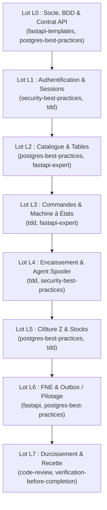

# Plan d'Implémentation Backend — Caisse MYK

> **Document de référence pour le déroulement du développement backend.**
> Aligné sur le dossier d'architecture v1.1 et découpé par lots avec mobilisation des **skills spécialisés**.
> Documents associés : [`00-ARCHITECTURE-GLOBALE.md`](./00-ARCHITECTURE-GLOBALE.md), [`01-BACKEND.md`](./01-BACKEND.md), [`03-CONTRAT-API.md`](./03-CONTRAT-API.md), [`04-EXPLOITATION-BACKEND.md`](./04-EXPLOITATION-BACKEND.md).

---

## 🗺️ Matrice Globale des Lots & Skills

| Lot | Thème | Durée estimée | Skills clés mobilisés | Livrable principal |
|---|---|:---:|---|---|
| **L0** | **Socle Technique & Contrat API** | Semaine 1 | `fastapi-templates`, `postgres-best-practices` | OpenAPI gelé, structure modulaire, socle Docker partagé |
| **L1** | **Identité, Rôles & Sessions** | Semaine 2 | `security-best-practices`, `tdd` | Auth PIN Argon2, JWT, ouverture session, journée comptable |
| **L2** | **Catalogue, Prix & Tables** | Semaine 2-3 | `fastapi-expert`, `postgres-best-practices` | CRUD catalogue, historique prix, vue agrégée salle |
| **L3** | **Commandes & Lignes** | Semaine 3-4 | `tdd`, `fastapi-python` | Machine à états commande, items figés, vente à emporter |
| **L4** | **Encaissement & Agent Spooler** | Semaine 4-5 | `postgres-best-practices`, `security-best-practices` | Transaction paiement atomique, idempotence, agent Windows |
| **L5** | **Clôture Z & Stocks** | Semaine 5-6 | `tdd`, `postgres-best-practices` | Rapport Z figé, dénominations, décrémentation stock |
| **L6** | **FNE & Pilotage** | Semaine 6-7 | `fastapi`, `improve-codebase-architecture` | FNE par ticket, outbox + rejeu, reporting dashboard |
| **L7** | **Durcissement & Recette** | Semaine 8 | `code-review`, `verification-before-completion` | Tests E2E, validation runbook de sauvegarde Windows |

---

## 🔹 Phase 0 : Socle Technique, Base de Données & Contrat OpenAPI (Lot L0 — S1)

### 1. Objectifs
- Initialiser le projet backend modulaire en couches (`domain/`, `models/`, `repositories/`, `services/`, `api/v1/`).
- Configurer l'infrastructure Docker partagée (`infra_shared`, PostgreSQL 16 avec cloisonnement `caisse` / `hotel_paix`).
- Mettre en place Alembic pour des migrations réversibles.
- Livrer tous les endpoints du contrat d'API en mode mocké pour débloquer immédiatement l'équipe frontend.

### 2. Skills mobilisés
- **`fastapi-templates`** : Structuration de l'application FastAPI, gestion de configuration Pydantic Settings, middlewares, gestionnaire global d'erreurs `problem+json`.
- **`postgres-best-practices`** : Modèles de base SQLAlchemy 2.0 (`Mapped[]`, UUIDv7, typage strict des montants `_xof` en entier).

### 3. Plan d'action détaillé
1. Initialiser `apps/api` (`pyproject.toml`, dépendances : FastAPI, SQLAlchemy, Alembic, Pydantic v2, Pydantic-Settings, asyncpg/psycopg).
2. Créer `src/caisse/config.py` et `src/caisse/database.py`.
3. Configurer Alembic avec support asynchrone / synchrone et gestion de rollback.
4. Mettre en place le socle Docker `infra/docker-compose.yml` et le script `init/01-bases.sh`.
5. Implémenter les routers dans `src/caisse/api/v1/` renvoyant les structures exactes décrites dans `03-CONTRAT-API.md`.
6. Ajouter les routes de healthcheck : `GET /health` et `GET /health/ready`.

### 4. Critères de validation (Definition of Done)
- [ ] `GET /openapi.json` est valide, complet et exportable pour générer les types frontend.
- [ ] Les conteneurs démarrent proprement avec `docker compose up -d`.
- [ ] Les bases `caisse` et `hotel_paix` sont créées et isolées.

---

## 🔹 Phase 1 : Identité, Sécurité & Sessions de Caisse (Lot L1 — S2)

### 1. Objectifs
- Implémenter l'authentification sécurisée par code PIN à 6 chiffres.
- Gérer les jetons JWT courts (15 min) et refresh (12 h) liés au `device_id`.
- Mettre en place la matrice de droits stricte (Caissier / Responsable / Admin) et l'élévation temporaire (`X-Override-Token`).
- Implémenter le cycle de vie d'une session de caisse (ouverture avec fonds, journée comptable, index unique partiel).

### 2. Skills mobilisés
- **`security-best-practices`** : Hachage des PINs avec Argon2id, gestion des expirations JWT, blocage progressif après 5 échecs, isolation des rôles.
- **`tdd`** : Développement piloté par les tests des règles métier de session (`domain/session_rules.py`).

### 3. Plan d'action détaillé
1. Modèles SQLAlchemy : `User`, `CashSession`, `CashMovement`, `AuditLog`.
2. Migration Alembic pour les tables d'authentification et de session.
3. Module `domain/session_rules.py` (vérification de journée comptable, validation du fonds initial).
4. Services : `AuthService`, `CashSessionService`, `AuditService`.
5. Endpoints :
   - `POST /api/v1/auth/login`
   - `POST /api/v1/auth/refresh`
   - `POST /api/v1/auth/override`
   - `GET /api/v1/auth/me`
   - `POST /api/v1/cash-sessions` (ouverture, idempotent)
   - `GET /api/v1/cash-sessions/current`
   - `POST /api/v1/cash-sessions/{id}/movements`
6. CLI d'administration : `python -m caisse.cli create-user` et `reset-pin`.

### 4. Critères de validation (Definition of Done)
- [ ] Test unitaire : blocage après 5 tentatives de PIN erronées.
- [ ] Test d'intégration : impossibilité d'ouvrir 2 sessions simultanées sur la même caisse.
- [ ] Audit log alimenté à chaque connexion et mouvement de tiroir.

---

## 🔹 Phase 2 : Catalogue Produits, Tarifs & Tables (Lot L2 — S2-S3)

### 1. Objectifs
- Modéliser le menu du restaurant : catégories, produits, groupes fiscaux, couleur, ordre d'affichage.
- Gérer l'historique et la traçabilité des modifications tarifaires.
- Gérer le plan de salle et le point d'accès agrégé haute performance pour la caisse.

### 2. Skills mobilisés
- **`fastapi-expert`** : Optimisation des schémas Pydantic pour sérialiser le catalogue sans surcharge mémoire.
- **`postgres-best-practices`** : Requête SQL agrégée optimisée pour le tableau de bord de la salle (`GET /tables/board`).

### 3. Plan d'action détaillé
1. Modèles : `Category`, `Product`, `ProductPriceHistory`, `RestaurantTable`.
2. Migration Alembic associée.
3. Services : `CatalogService` (avec historisation des prix si modification), `TableService`.
4. Endpoints :
   - `GET /api/v1/catalog/categories` & `POST /api/v1/catalog/categories` (R/A)
   - `GET /api/v1/catalog/products` & `POST /api/v1/catalog/products` (R/A)
   - `PATCH /api/v1/catalog/products/{id}/price` (R/A avec motif tracé)
   - `GET /api/v1/tables` & `GET /api/v1/tables/board` (vue temps réel optimisée)
5. Commande CLI : `python -m caisse.cli import-catalog /data/menu.csv` et `create-tables`.

### 4. Critères de validation (Definition of Done)
- [ ] Import complet du menu réel via CSV.
- [ ] Modification d'un prix enregistrant bien une entrée dans `product_price_history`.
- [ ] `GET /tables/board` exécuté en une seule requête SQL sans problème N+1.

---

## 🔹 Phase 3 : Prise de Commande & Machine à États (Lot L3 — S3-S4)

### 1. Objectifs
- Implémenter le cycle de vie strict des commandes (`OPEN` ➔ `PARTIALLY_PAID` ➔ `PAID` / `CANCELLED` / `REFUNDED`).
- Figer le nom et le prix unitaire sur chaque ligne ajoutée (snapshot immuable).
- Supporter les produits personnalisés hors-menu (`is_custom = true`) et les ventes à emporter (`table_id = null`).
- Tracer tout retrait de ligne validée ou annulation de commande (nécessite motif + PIN responsable).

### 2. Skills mobilisés
- **`tdd`** : Tests exhaustifs des transitions d'états et du calcul des totaux dans `domain/order_rules.py`.
- **`fastapi-python`** : Isolation complète de la logique métier dans `domain/` sans couplage avec le framework web.

### 3. Plan d'action détaillé
1. Modèles : `Order`, `OrderItem`.
2. Migration Alembic avec index unique partiel : au plus 1 commande active par table (`OPEN` ou `PARTIALLY_PAID`).
3. Module `domain/order_rules.py` (calcul des totaux TTC, calcul ventilation HT/TVA, vérification d'état modifiable).
4. Services : `OrderService`.
5. Endpoints :
   - `POST /api/v1/orders` (création sur table ou à emporter)
   - `GET /api/v1/orders/{id}` & `GET /api/v1/orders` (filtres)
   - `POST /api/v1/orders/{id}/items` (ajout lignes ou produit sur-mesure)
   - `DELETE /api/v1/orders/{id}/items/{item_id}` (retrait tracé avec motif)
   - `POST /api/v1/orders/{id}/cancel` (annulation avec motif + PIN responsable)

### 4. Critères de validation (Definition of Done)
- [x] Impossible d'ajouter ou retirer une ligne sur une commande `PAID` ou `CANCELLED`.
- [x] Le prix de la ligne reste inchangé même si le prix du produit dans le catalogue augmente ensuite (snapshots).
- [x] Retrait de ligne enregistré dans l'audit sans suppression physique de la ligne (soft removal tracé).

---

## 🔹 Phase 4 : Encaissement, Idempotence & Agent d'Impression Spooler (Lot L4 — S4-S5)

### 1. Objectifs
- Enregistrer les paiements (espèces avec rendu monnaie, Mobile Money avec référence, paiements mixtes).
- Garantir l'atomicité complète de l'encaissement (DB + décrément stock + outbox FNE + job impression).
- Empêcher les doubles paiements grâce aux clés d'idempotence (`idempotency_records`).
- Développer l'agent d'impression Windows `apps/print-agent` communiquant avec le spooler Windows (`win32print`) et gérant l'ouverture du tiroir.

### 2. Skills mobilisés
- **`postgres-best-practices`** : Verrouillage pessimiste `with_for_update()` sur la commande pour prévenir les courses d'encaissement concurrentes.
- **`security-best-practices`** : Gestion de l'idempotence et traçabilité des duplicatas / ré-impressions.

### 3. Plan d'action détaillé
1. Modèles : `Payment`, `PrintJob`, `IdempotencyRecord`.
2. Migration Alembic.
3. Implémentation du service transactionnel `payment_service.py` :
   - Verrouillage `SELECT ... FOR UPDATE`.
   - Calcul du reste dû.
   - Si solde atteint (`due_xof == 0`) ➔ bascule `PAID`, sortie stock, création FNE et mise en file du ticket.
4. Middleware / Dépendance FastAPI pour la gestion d'idempotence avec en-tête `Idempotency-Key`.
5. Développement de l'agent Windows (`apps/print-agent`) :
   - `spooler_driver.py` : écriture brute dans le Spooler Windows (`win32print.WritePrinter`).
   - Endpoints `/status`, `/print`, `/open-drawer`, `/test-print`.
6. Templates de tickets texte et commandes ESC/POS tiroir côté backend.

### 4. Critères de validation (Definition of Done)
- [x] Deux requêtes identiques avec la même `Idempotency-Key` renvoient la même réponse sans créer de doublon.
- [x] Encaissement soldé génère le job d'impression avec impulsion tiroir (`open_drawer=True` sur espèces).
- [x] Mode dégradé : si l'imprimante est coupée, la vente aboutit et le ticket reste en attente (`QUEUED`).

---

## 🔹 Phase 5 : Clôture de Caisse (Z/X) & Gestion des Stocks (Lot L5 — S5-S6)

### 1. Objectifs
- Permettre la consultation du Rapport X intermédiaire à tout moment.
- Réaliser la clôture définitive (Rapport Z numéroté) avec saisie des espèces comptées par coupures (billets/pièces) et calcul automatique de l'écart.
- Suivre les mouvements de stock sur les boissons/produits revendus et gérer les alertes de seuil bas.

### 2. Skills mobilisés
- **`tdd`** : Tests unitaires sur les calculs de dénominations, totaux HT/TVA et écarts de caisse (`domain/session_rules.py`).
- **`postgres-best-practices`** : Requêtes d'agrégation performantes pour le calcul des totaux par catégorie et moyen de paiement.

### 3. Plan d'action détaillé
1. Modèles : `StockItem`, `StockMovement`.
2. Migration Alembic.
3. Service de stock : `StockService` (sorties automatiques à l'encaissement, ajustements d'inventaire, entrées manuelles).
4. Service de clôture :
   - `GET /api/v1/cash-sessions/{id}/x-report` (calcul temps réel non destructif).
   - `POST /api/v1/cash-sessions/{id}/close` (clôture irréversible, attribution du numéro Z, snapshot complet des totaux).
   - `GET /api/v1/cash-sessions/{id}/z-report` (consultation du rapport figé).
5. Endpoints de stock : `GET /api/v1/stock`, `POST /api/v1/stock/movements`, `POST /api/v1/stock/inventory`.

### 4. Critères de validation (Definition of Done)
- [x] Clôture impossible s'il reste des commandes ouvertes dans la session (`UNSETTLED_ORDERS_REMAIN`).
- [x] Le numéro de rapport Z est séquentiel et immuable après clôture (`z_number` + snapshot figé).
- [x] Stock négatif autorisé mais tracé avec alerte visuelle (`is_low_stock = True`).

---

## 🔹 Phase 6 : Facturation Normalisée (FNE) & Tableau de Bord (Lot L6 — S6-S7)

### 1. Objectifs
- Émettre un ticket de caisse standard pour tout encaissement B2C sans latence externe.
- Émettre une Facture Normalisée Électronique (FNE) **à la demande** (clients entreprises B2B avec NCC / NIF), soit directement à l'encaissement, soit *a posteriori*.
- Mettre en œuvre le pattern Outbox avec attente bornée à 4 secondes lors de l'émission FNE puis repli automatique en file de rejeu asynchrone.
- Fournir un export CSV/JSON des factures normalisées et un adaptateur prêt pour l'API DGI directe.
- Exposer les indicateurs de pilotage (CA du jour, ventilation des paiements, top produits).

### 2. Skills mobilisés
- **`fastapi`** : Worker asynchrone d'arrière-plan (`asyncio` / APScheduler) pour le dispatch des événements Outbox.
- **`improve-codebase-architecture`** : Architecture hexagonale avec Ports & Adapters (`ManualFneProvider`, `ApiFneProvider`, `MockFneProvider`).

### 3. Plan d'action détaillé
1. Modèles : `Customer`, `FneDocument`, `OutboxEvent`.
2. Migration Alembic.
3. Module `domain/fiscal.py` (construction du payload fiscal normalisé B2B/B2C, figé en JSONB).
4. Adaptateurs FNE dans `src/caisse/infrastructure/fne/` :
   - `ManualFneProvider` (génération locale + export pour le logiciel FNE existant).
   - `MockFneProvider` (pour les tests et dev front).
   - `ApiFneProvider` (soumission REST avec timeout de 4 s).
5. Worker Outbox pour le rejeu automatique avec backoff exponentiel.
6. Endpoints :
   - `POST /api/v1/fne/generate` (émission d'une FNE à la demande pour une commande soldée)
   - `GET /api/v1/fne/documents` & `POST /api/v1/fne/documents/{id}/retry` & `GET /api/v1/fne/export`
   - `GET /api/v1/customers` & `POST /api/v1/customers` (recherche & gestion NCC)
   - `GET /api/v1/reports/dashboard` (KPIs temps réel pour le responsable)

### 4. Critères de validation (Definition of Done)
- [x] Encaissement standard instantané avec reçu de vente (sans FNE systématique).
- [x] Génération de FNE à la demande (au paiement ou a posteriori) avec données entreprise du client.
- [x] Une coupure réseau ne bloque jamais l'encaissement ni l'émission FNE (passage transparent en `QUEUED`).
- [x] Le payload fiscal est strictement immuable une fois généré.

---

## 🔹 Phase 7 : Durcissement, Recette & Exploitation Windows (Lot L7 — S8)

### 1. Objectifs
- Valider la suite de tests automatisés (Unitaires, Intégration, E2E).
- Valider le runbook d'exploitation sous Windows (Docker Desktop, NSSM, sauvegardes PowerShell).
- Réaliser la recette complète en conditions réelles de service.

### 2. Skills mobilisés
- **`code-review`** : Audit statique complet du code, conformité aux règles d'architecture et absence de dette technique.
- **`verification-before-completion`** : Exécution des scripts de tests et preuve de bon fonctionnement avant livraison.

### 3. Plan d'action détaillé
1. Écriture du scénario E2E complet (`tests/e2e/test_service_complet.py`) :
   - Ouverture session ➔ Prise de commandes ➔ Retrait de ligne supervisé ➔ Encaissement mixte ➔ Impression ➔ Clôture Z ➔ Export FNE.
2. Test réel de coupure / reprise :
   - Débranchement du câble USB de l'imprimante ➔ Vente ➔ Rebranchement ➔ Dépilement automatique des tickets.
3. Validation du script PowerShell de sauvegarde `backup-caisse.ps1` et test de restauration sur une base de test.
4. Validation de la configuration du service Windows NSSM pour l'agent d'impression.

### 4. Critères de validation (Definition of Done)
- [x] 100% des tests automatisés passent avec succès (52 tests unitaires, d'intégration et E2E).
- [x] Procédure de restauration testée et documentée (`docs/RUNBOOK-EXPLOITATION-WINDOWS.md`, `scripts/backup-caisse.ps1`, `scripts/restore-caisse.ps1`).
- [x] Validation finale et contrat d'API synchronisé (`openapi.json`).
